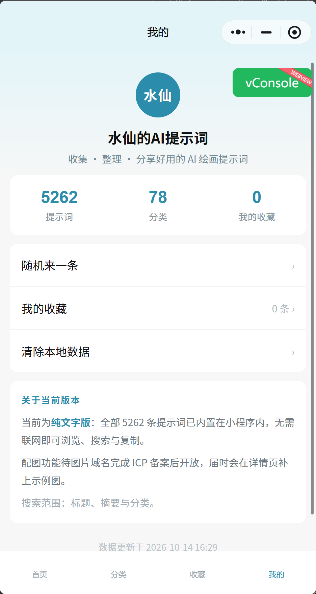
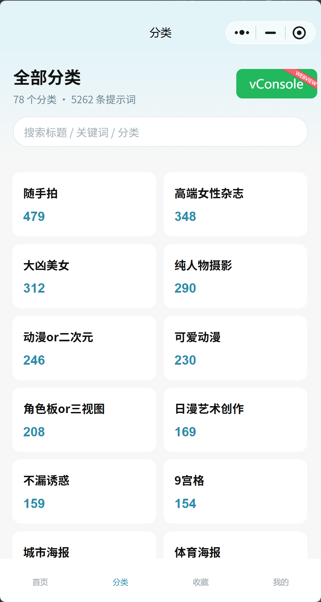

# 水仙的AI提示词 · 微信小程序（纯文字离线版）

## ▸ 微信小程序已上线：水仙AI

### 微信内打开 **`#小程序://水仙AI/LHxQxRquVzOWT9g`**，或直接在微信搜索「水仙AI」即可进入。

> 5,262 条中文 AI 绘画提示词，压缩内置进包。不联网、不依赖任何服务器和域名，导入微信开发者工具即可用。

提示词覆盖 Midjourney、Stable Diffusion、Flux、ChatGPT、Gemini，以及即梦、可灵、豆包、海螺、文心一格等主流生图模型。

## 界面截图

<p>
  
  
  
  
  
</p>

## 为什么是离线版

所有提示词以 `raw deflate(level 9) + base64` 压缩内置在包内（约 5.3 MB / 20 MB 上限），运行时由 `utils/inflate.js` 即时解压，原文零丢失。因此完全绕开 `r2.qqsrc.com` 尚未备案的问题。

图片仅保存 R2 的 URL 字符串、**不打包任何图片字节**；展示开关在 `app.js` 的 `showImage` / `imageBase`，等域名备案完成后打开即可。

## 功能

- 78 个分类浏览，每个分类带数量
- 关键词搜索（标题 + 摘要 + 分类三路）
- 最新列表：按 id 降序，上拉分页
- 详情页：标题 + 分类 + prompt 全文 + 一键复制
- 本地收藏（`wx.setStorageSync`），可单条移除或清空
- 6 个页面：首页 / 分类 / 列表 / 详情 / 收藏 / 我的

## 目录结构

```
pages/        6 个页面（首页 / 分类 / 列表 / 详情 / 收藏 / 我的）
utils/        store.js（数据访问层）/ fav.js（收藏）
              inflate.js · meta.js · loaders.js（后三者自动生成，勿手改）
packages/     数据分包：i0（索引）+ b0~b2（正文，raw deflate + base64）
scripts/      build_miniprogram_data.py · mp_integration_test.js · tiny_inflate_src.js
```

## 数据说明

| 文件 | 内容 |
|---|---|
| `packages/i0/data.js` | 索引：id、标题、分类号、40 字摘要、所属正文分包号、图片 URL |
| `packages/b0~b2/data.js` | 正文：raw deflate + base64 |
| `utils/meta.js` | 分类表 / 分包表 / 解压缓冲长度 |
| `utils/loaders.js` | 分包异步加载器 |

每条保留 `id` `title` `category` `prompt` `image` 五个字段（image 为 R2 URL，展示待备案），其余 author / thumb / likes 等已丢弃。

规模：**5,262 条 / 78 个分类**（剔除 168 条「其他/未归类」）；其中 **383 条「大凶」类**随其他类别携带 R2 图片 URL。

## 本地导入与构建

用微信开发者工具导入，无需任何后端：

1. 导入项目 → 目录选本仓库
2. AppID 换成你自己的（当前占位 `touristappid`，测试号无法发布）
3. 首次编译约 5.3 MB 源码，之后走增量

```bash
python scripts/build_miniprogram_data.py      # 重新生成数据（--dry-run 只测算体积）
node scripts/mp_integration_test.js            # 集成测试（无需开发者工具）
```

> 数据源默认读环境变量 `MP_SRC_DATA`，否则 `../shuixian-unified-0920/data`；目录不存在时测试自动跳过（exit 0）。

## 相关项目

| 项目 | 说明 |
|---|---|
| [shuixian-prompts](https://github.com/BaYue-SYJ/shuixian-prompts) | 同一份提示词库的网页版（现代版 + 经典版双皮肤，在线逛库） |
| [shuixian-manju-skills](https://github.com/BaYue-SYJ/shuixian-manju-skills) | 短剧漫剧 6 件套：从小说到成片的创作技能 |
| [threads-ai-radar](https://github.com/BaYue-SYJ/threads-ai-radar) | Threads 爆款雷达，按互动量排榜 |
| [zimeiti-workbuddy](https://github.com/BaYue-SYJ/zimeiti-workbuddy) | Creator Buddy：公众号 / 小红书 / 短视频创作工具箱 |
| [web-html-image-skill](https://github.com/BaYue-SYJ/web-html-image-skill) | web-image：用 HTML/CSS 出图，不依赖生图模型 |
| [Awesome-shuixian-prompts-archive](https://github.com/BaYue-SYJ/Awesome-shuixian-prompts-archive) | 水仙画廊（shuixian-prompts）的历史版本归档 |

## 许可

采用**署名使用**协议：可自由学习、fork、二次开发、非商业转载，但请**保留出处并链接回本仓库**；衍生项目需写清来源；商业用途需先联系作者获取授权。详见 [LICENSE](LICENSE)。

仓库内的提示词原文与图片来自公开渠道的整理与收录，**版权归各自原作者**，本项目只做整理、分类与展示。商用请自行确认权利来源。

## 联系

- 站点：[https://prompt.qqsrc.com/](https://prompt.qqsrc.com/)
- 小程序：微信内打开 `#小程序://水仙AI/LHxQxRquVzOWT9g`，或搜索「水仙AI」
- 公众号：**水仙的AI提示词** —— 会经常写一些 AI 工具与提示词相关的东西
- 微信：**Kas2026** —— 公益免费交流群，不收取任何费用，喜欢技术的可以一起交流
- 投稿、纠错、建议：欢迎开 [Issue](https://github.com/BaYue-SYJ/shuixian-prompts/issues)

## 致谢

- Linux.Do 与社区分享、讨论和跟踪发展 —— 认可 LINUX DO 社区
